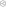

<h1 align="center">
  <picture>
    <source media="(prefers-color-scheme: dark)" srcset="./media/logo_light.svg">
    <source media="(prefers-color-scheme: light)" srcset="./media/logo_dark.svg">
    <!-- The fallback image for older browsers -->
    
  </picture>
   
</h1>

# Node Toolbox

Blender node tools. `expose_inputs/` exposes child group inputs to Group Input with nested panels.
